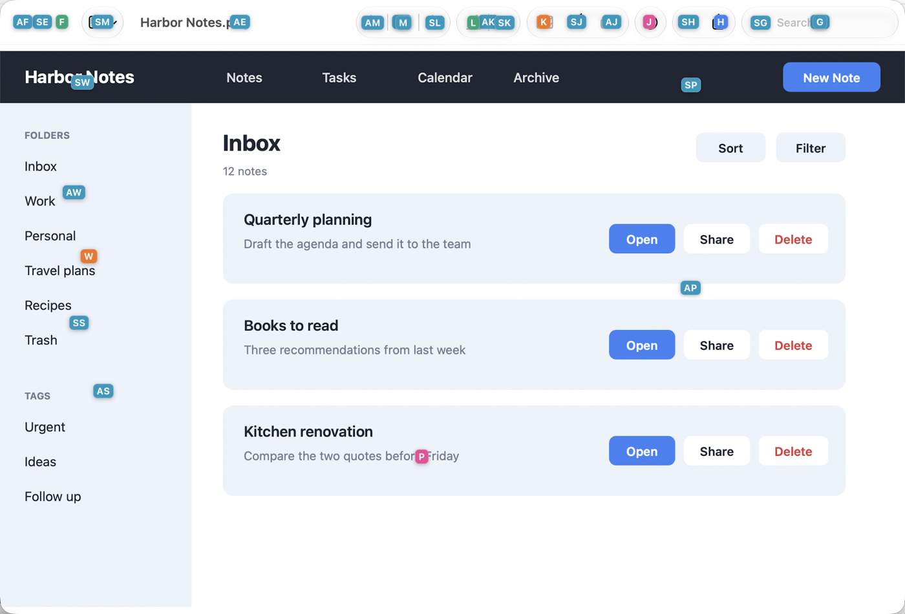
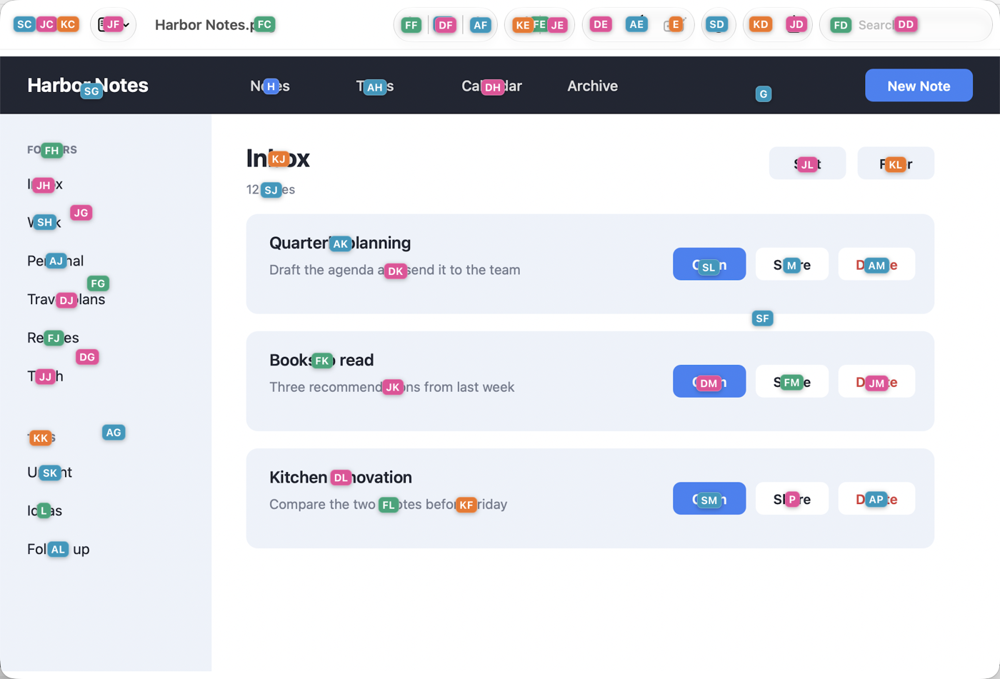
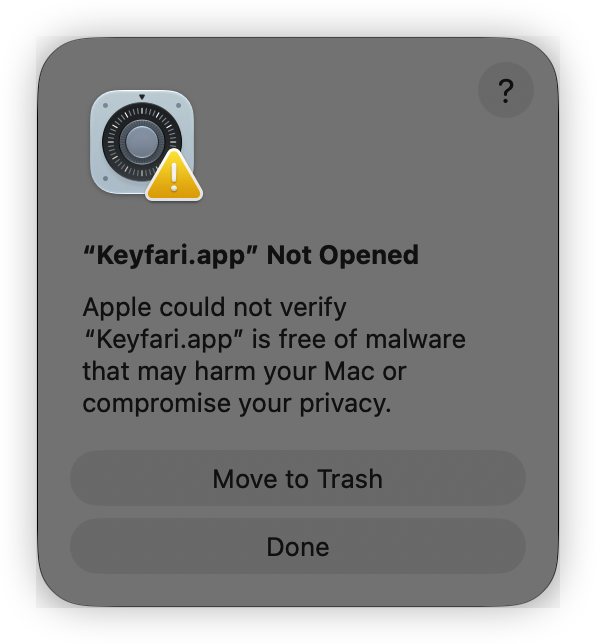
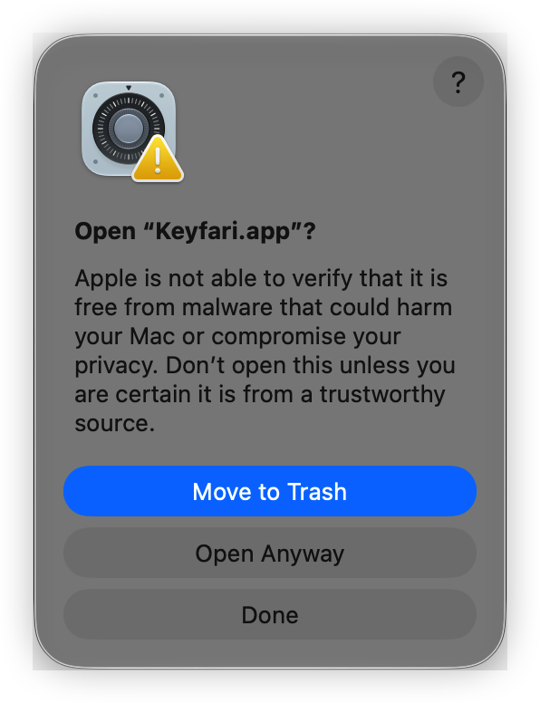
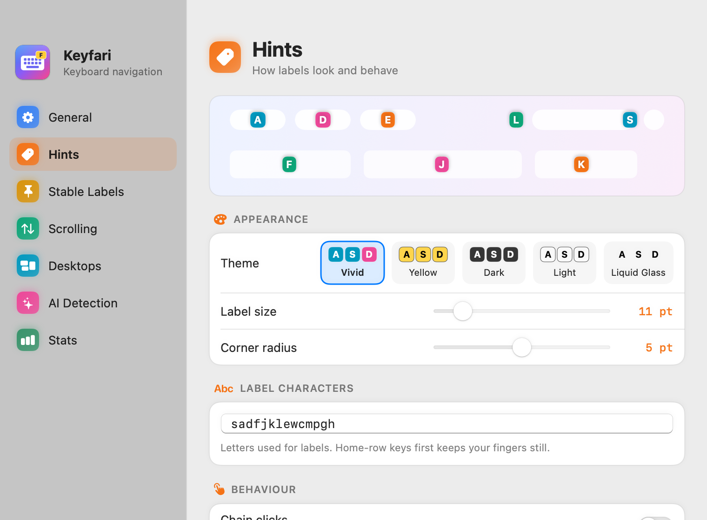

# Keyfari

[English](README.md) · [简体中文](README.zh-CN.md) · **日本語**

> **マウスの代わりに、キーボードを。**

キーボードで Mac を操作できます。**⌘⇧Space（Command + Shift + スペース）** を押すと、すべてのディスプレイでボタンやリンク、メニュー項目の横に英字のラベルが表示されます。その文字を入力すると、対応する項目をクリックできます。

Keyfari は Vimac や Homerow の代わりに使える、無料のオープンソースアプリです。名前でボタンを探す、ページをスクロールする、Mission Control でウインドウを選ぶといった操作にも対応しています。Mac 上で動作する文字認識を有効にすると、画像内の文字にもラベルが付きます。

| 「プレビュー」での通常のラベル表示 | 文字認識を有効にした場合 |
| --- | --- |
|  |  |

## インストール

Apple シリコンまたは Intel プロセッサ搭載の Mac で、**macOS 14 Sonoma 以降**が必要です。

**Homebrew を使う場合**

```sh
brew install --cask hodgekou/keyfari/keyfari
```

**直接ダウンロードする場合** — [最新リリース](https://github.com/hodgekou/keyfari/releases/latest)の **Assets** から `.dmg` ファイルをダウンロードします。ファイルを開き、**Keyfari** を「アプリケーション」フォルダにドラッグします。

## 初回起動

1. 「アプリケーション」から Keyfari を開きます。macOS がアプリを検証できないという警告を表示したら、「完了」をクリックします。

   

   [GitHub Pages で初回起動の手順をスクリーンショット付きで見る](https://hodgekou.github.io/keyfari/#first-launch)

2. 「システム設定 → プライバシーとセキュリティ」の「セキュリティ」で Keyfari に関するメッセージを探し、「このまま開く」をクリックします。
3. もう一度、Keyfari を開くかどうかを確認する画面が表示されます。中央の **「このまま開く」** をクリックし、パスワードまたは Touch ID で認証してください。青いボタンは **「ゴミ箱に入れる」** です。クリックすると Keyfari がゴミ箱に移動するのでご注意ください。

   

4. ウェルカムガイドに従い、クリックやスクロールに必要な「アクセシビリティ」を許可します。画像内の文字にもラベルを表示するには、「画面収録」を許可し、Keyfari の設定で文字認識を有効にします。

## Finder で試す

Finder のウインドウを開き、**⌘⇧Space** を押してからキーを放します。フォルダの横に表示された文字を順番に入力すると、そのフォルダをクリックできます。**Esc** でキャンセルできます。

| 操作 | 初期ショートカット | 次の操作 |
| --- | --- | --- |
| クリック・右クリック | ⌘⇧Space | ラベルを入力します。最後の文字を Shift キーを押しながら入力すると右クリックになります。 |
| 名前で項目を検索 | ⌘⇧/ | 名前の一部を入力し、矢印キーで候補を選び、Return で確定します。 |
| スクロール | ⌘⇧J | J で下へ、K で上へスクロールします。Esc で終了します。 |
| ウインドウを選択 | Mission Control で ⌘⇧Space | 選びたいウインドウのラベルを入力します。 |

## 設定とアップデート

メニューバーの Keyfari アイコンから設定を開くと、ショートカットやラベルの外観を変更したり、設定と記憶済みのラベルを書き出したりできます。アイコンを非表示にしている場合は、「アプリケーション」から Keyfari をもう一度開いてください。



Keyfari は毎日アップデートを確認します。手動で確認するには、メニューの「アップデートを確認…」を選びます。バージョン 0.3.0 以前からアップデートする場合、「アクセシビリティ」と「画面収録」の許可を再度求められることがあります。

## プライバシー

文字認識は Mac 上で実行され、スクリーンショットはメモリ内にのみ保持されます。設定、記憶済みのラベル、任意の利用統計も Mac 内に保存されます。ネットワーク接続はアップデートの確認とダウンロードにのみ使用します。自動確認は設定で無効にできます。

## 開発に参加する

ローカルでのビルドや変更の提出については、[コントリビューションガイド](CONTRIBUTING.md)をご覧ください。不具合は [GitHub Issues](https://github.com/hodgekou/keyfari/issues) へお寄せください。セキュリティ上の問題の報告手順は[セキュリティポリシー](SECURITY.md)に記載されています。

[公式サイト](https://hodgekou.github.io/keyfari/) · [変更履歴](CHANGELOG.md) · [GPL-3.0 ライセンス](LICENSE)
