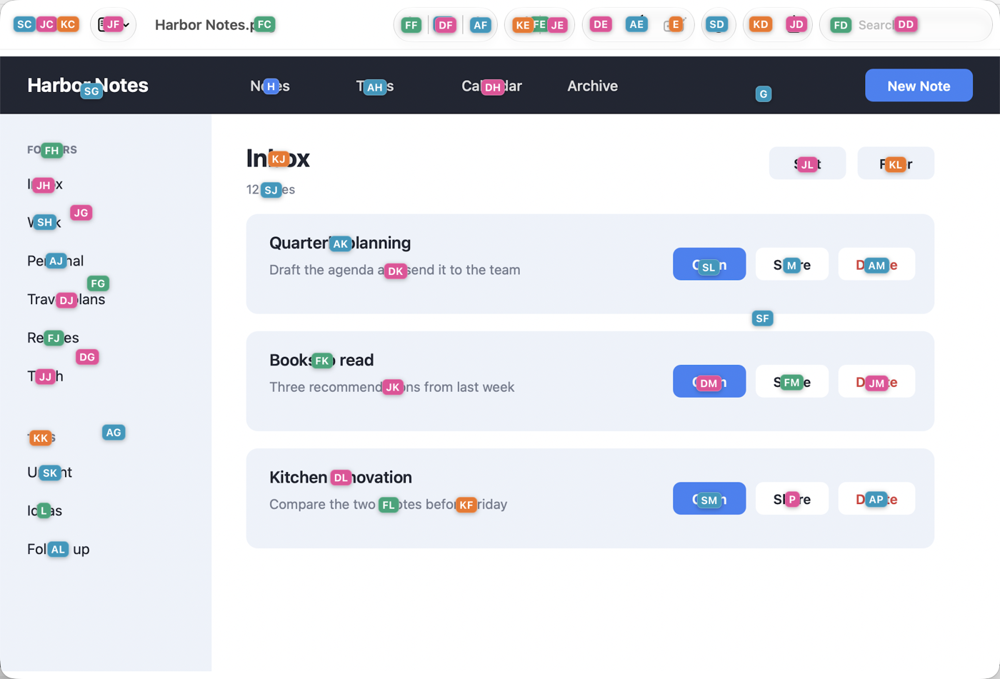
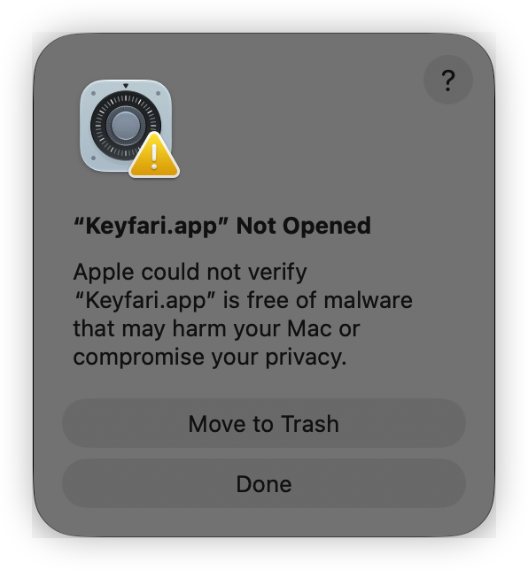

# Keyfari

**English** · [简体中文](README.zh-CN.md) · [日本語](README.ja.md)

Navigate your Mac with the keyboard. Press **⌘⇧Space** to show letter labels on buttons, links and menu items across all displays. Type a label to click its target.

Keyfari is a free, open-source alternative to Vimac and Homerow. It also lets you find controls by name, scroll pages and select windows in Mission Control. Optional on-device text recognition extends labels to text inside images.

| Standard labels in Preview | With text detection enabled |
| --- | --- |
|  |  |

## Install

Requires **macOS 14 Sonoma or later** on Apple silicon or Intel.

**Homebrew**

```sh
brew install --cask hodgekou/keyfari/keyfari
```

**Direct download** — Download the `.dmg` under **Assets** on the [latest release](https://github.com/hodgekou/keyfari/releases/latest). Open it and drag **Keyfari** into **Applications**.

## First launch

1. Open Keyfari from Applications. If macOS says it could not verify the app, click **Done**.

   

   [Follow the first-launch guide with screenshots on GitHub Pages](https://hodgekou.github.io/keyfari/#first-launch)

2. In **System Settings → Privacy & Security → Security**, find the Keyfari message and click **Open Anyway**.
3. macOS asks once more. Click **Open Anyway**, the middle button, and confirm with your password or Touch ID. The blue button here is **Move to Trash**, so take care not to click it out of habit.

   

4. Follow the Welcome Guide to grant **Accessibility** access for clicking and scrolling. For labels on text inside images, grant **Screen Recording** access and enable text detection in Keyfari’s settings.

## Try it in Finder

Open a Finder window, press **⌘⇧Space**, then release the keys. Type the letters beside a folder to click it. Press **Esc** to cancel.

| Action | Default shortcut | Next step |
| --- | --- | --- |
| Click or right-click | ⌘⇧Space | Type the label. Hold Shift on the last letter for a right-click. |
| Find a control by name | ⌘⇧/ | Type part of the name, select a match with the arrow keys and press Return. |
| Scroll | ⌘⇧J | Press J to scroll down, K to scroll up and Esc to finish. |
| Select a window | ⌘⇧Space in Mission Control | Type the window’s label. |

## Settings and updates

Open **Settings** from Keyfari’s menu bar icon to change shortcuts, adjust label appearance or export settings and remembered labels. If the icon is hidden, reopen Keyfari from Applications.


Keyfari checks for updates daily. Choose **Check for Updates…** in its menu for a manual check. When upgrading from 0.3.0 or earlier, you may need to grant Accessibility and Screen Recording access again.

## Privacy

Text recognition runs on your Mac. Screenshots stay in memory, and settings, remembered labels and optional usage statistics stay on the device. Keyfari uses the network to check for and download updates. You can disable automatic checks in Settings.

## Contributing

To build Keyfari locally or submit a change, see the [contributing guide](CONTRIBUTING.md). Use [GitHub Issues](https://github.com/hodgekou/keyfari/issues) for bugs and the [security policy](SECURITY.md) for security reports.

[Website](https://hodgekou.github.io/keyfari/) · [Changelog](CHANGELOG.md) · [GPL-3.0 license](LICENSE)
