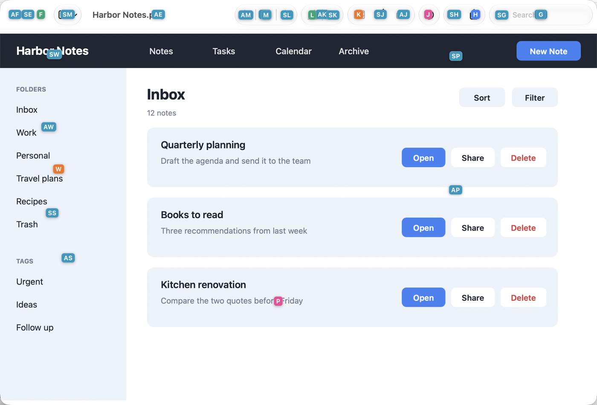
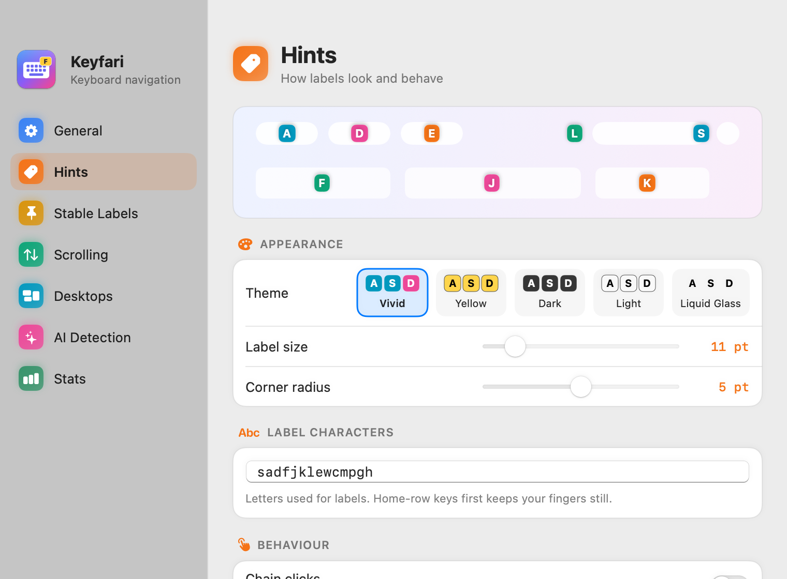

# Keyfari

Keyfari is a free, open-source alternative to Vimac and Homerow for navigating your Mac with the keyboard, built to be the better choice: nothing is locked behind a paid tier, labels appear on every display at once, text detection runs on your Mac, and there is no telemetry. Press a shortcut to put letter labels on buttons, links and menu items, then type a label to click. You can also search for a button by name, label text inside images, or pick a window in Mission Control without reaching for the mouse.

## Install

Keyfari runs on macOS 14 (Sonoma) or later, on both Apple silicon and Intel Macs.

1. Open the [latest release](https://github.com/hodgekou/keyfari/releases/latest). Under **Assets**, download the file ending in **.dmg**.
2. Double-click the downloaded file and drag **Keyfari** onto the **Applications** folder in the window.
3. Open **Applications** in Finder and double-click **Keyfari**.

If you already use Homebrew, you can install Keyfari with one command, then open it from Applications:

```sh
brew install --cask hodgekou/keyfari/keyfari
```

## Open Keyfari for the first time

If macOS says it can’t verify Keyfari, dismiss the alert. Open **System Settings → Privacy & Security**, scroll down to **Security**, and click **Open Anyway** beside the message naming Keyfari. Confirm when prompted. [See the steps with screenshots](https://hodgekou.github.io/keyfari/#first-launch).

The welcome guide will ask you to allow **Accessibility** so Keyfari can click and scroll in other apps. **Screen Recording** is optional. Enable it if you want Keyfari to recognise text inside images or windows where ordinary labels are missing.

## Try your first click

Open a Finder window. Press **Command + Shift + Space** together, then release them. Look at the letters beside the folder or button you want and type those letters in order. Keyfari clicks it for you. Press **Esc** at any time to cancel.

| To… | Press | Then… |
| --- | --- | --- |
| Click something you can see | **Command + Shift + Space** | Type its label. For a right-click, hold **Shift** while typing the last letter. |
| Find something by name | **Command + Shift + /** | Type part of its name, use the arrow keys to select a match, then press **Return**. |
| Scroll a page | **Command + Shift + J** | Press **J** to scroll down or **K** to scroll up. Press **Esc** to finish. |
| Pick a window in Mission Control | Open Mission Control, then press **Command + Shift + Space** | Type the label on the window you want. |

## When a button has no label

Try turning on **text detection** in Keyfari’s settings. Here, Preview is displaying a picture of an app. Text detection lets you point to the words inside that picture.

| Text detection off | Text detection on |
| --- | --- |
|  |  |

## Settings and updates

Click the **Keyfari icon in the menu bar** to open Settings or revisit the **Welcome Guide**. In Settings you can change shortcuts, make labels easier to read, or export your settings and remembered labels to take them to another Mac. If you’ve hidden the menu bar icon, open Keyfari again from Applications to reach Settings.



Keyfari checks for updates daily. To check now, choose **Check for Updates…** from its menu. If you upgrade from 0.3.0 or earlier, macOS may ask you to grant Accessibility and Screen Recording again.

## Privacy

Text recognition happens on your Mac. Screenshots stay in memory. Settings, remembered labels and optional usage statistics stay on your Mac too. Keyfari contacts the network only to check for and download updates. You can turn automatic checks off in Settings.

[Keyfari website](https://hodgekou.github.io/keyfari/) · [Report a problem](https://github.com/hodgekou/keyfari/issues) · [GPL-3.0 license](LICENSE)
