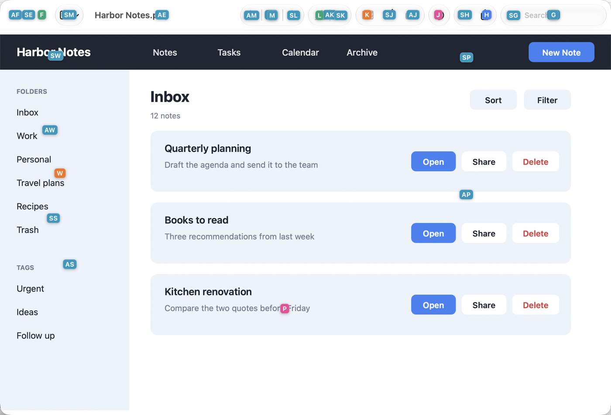
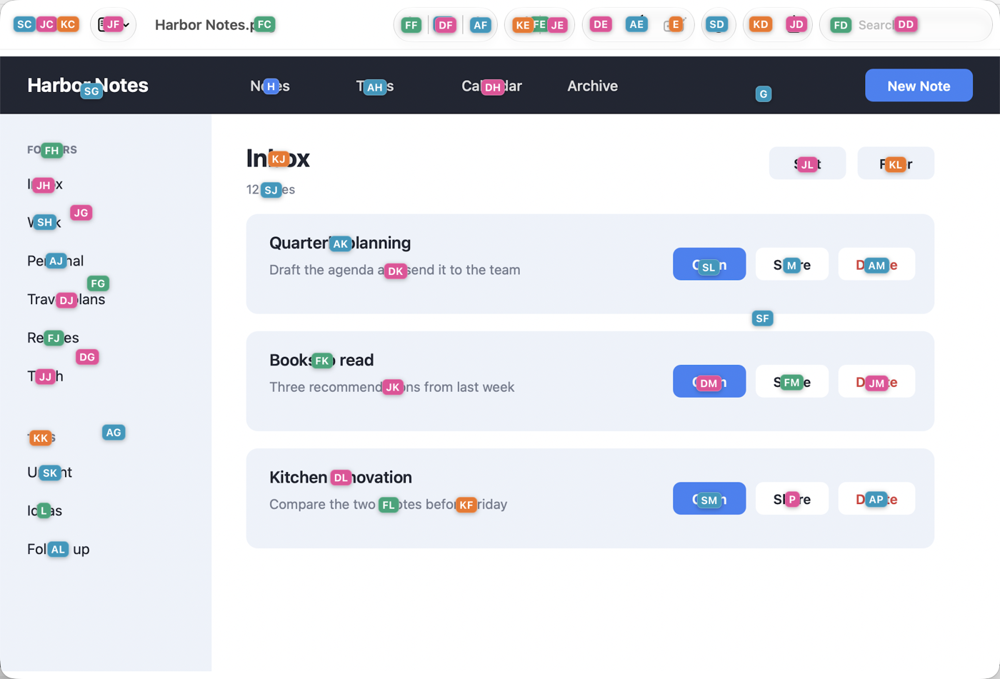
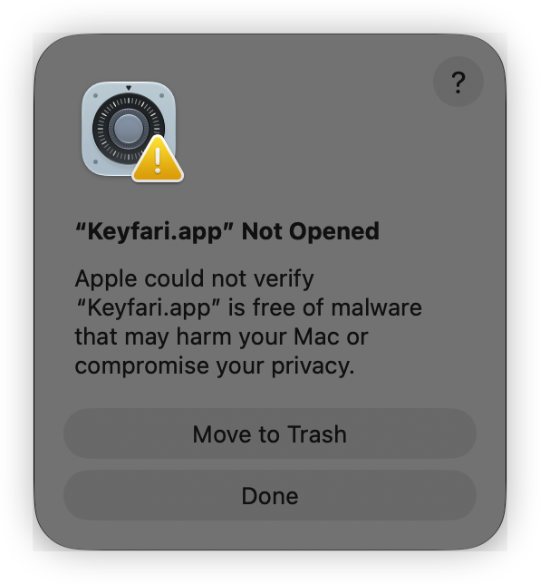
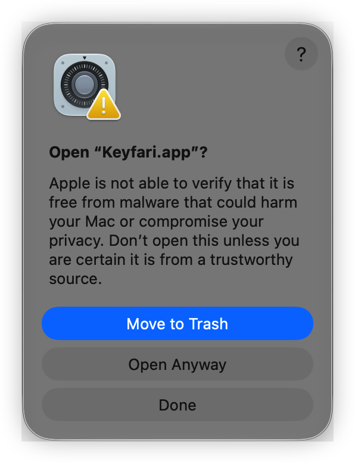
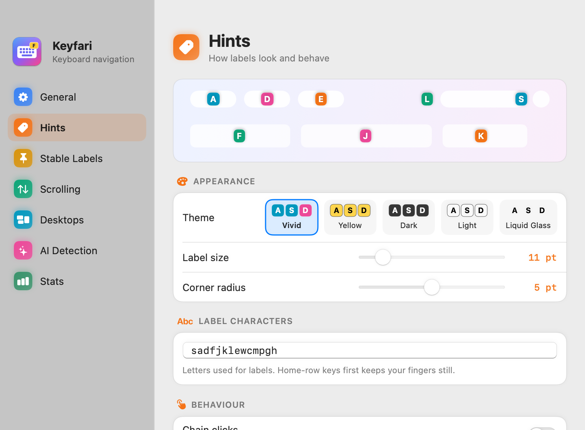

# Keyfari

[English](README.md) · **简体中文** · [日本語](README.ja.md)

> **键盘代替鼠标**

用键盘操作 Mac。按下 **⌘⇧Space（Command + Shift + 空格）**，所有显示器上的按钮、链接和菜单项旁都会出现字母标签。输入标签即可点击对应的项目。

Keyfari 是 Vimac 和 Homerow 的免费开源替代工具。你还可以按名称查找控件、滚动页面，或在调度中心选择窗口。开启本地文字识别后，图片里的文字也能显示标签。

| “预览”中的默认标签 | 开启文字识别后 |
| --- | --- |
|  |  |

## 安装

支持搭载 Apple 芯片或 Intel 处理器的 Mac，需要 **macOS 14 Sonoma 或更高版本**。

**通过 Homebrew 安装**

```sh
brew install --cask hodgekou/keyfari/keyfari
```

**直接下载** — 在[最新发行版](https://github.com/hodgekou/keyfari/releases/latest)的 **Assets** 下下载 `.dmg` 文件。打开文件，将 **Keyfari** 拖入“应用程序”文件夹。

## 首次启动

1. 从“应用程序”打开 Keyfari。如果 macOS 提示无法验证该应用，点“完成”。

   

   [前往 GitHub Pages 查看首次启动的完整图文指南](https://hodgekou.github.io/keyfari/#first-launch)

2. 打开“系统设置 → 隐私与安全性”，在“安全性”区域找到关于 Keyfari 的提示，点“仍要打开”。
3. macOS 会再次询问是否打开 Keyfari。请点中间的 **“仍要打开”**，再用密码或 Touch ID 确认。蓝色按钮是 **“移到废纸篓”**，点它会把 Keyfari 移到废纸篓，请留意。

   

4. 跟随欢迎指南授予“辅助功能”权限，以便 Keyfari 执行点击和滚动操作。如果需要为图片中的文字添加标签，请授予“屏幕录制”权限，并在 Keyfari 设置中开启文字识别。

## 在访达中试用

打开一个访达窗口，按下 **⌘⇧Space** 后松开，再依次输入某个文件夹旁的字母，即可点击该文件夹。按 **Esc** 可取消。

| 操作 | 默认快捷键 | 接下来怎么做 |
| --- | --- | --- |
| 单击或右键单击 | ⌘⇧Space | 输入标签。输入最后一个字母时按住 Shift 即可右键单击。 |
| 按名称查找控件 | ⌘⇧/ | 输入部分名称，用方向键选择匹配项，按回车确认。 |
| 滚动页面 | ⌘⇧J | 按 J 向下滚动，按 K 向上滚动，按 Esc 结束。 |
| 选择窗口 | 在调度中心按 ⌘⇧Space | 输入目标窗口上的标签。 |

## 设置与更新

点菜单栏里的 Keyfari 图标，打开“设置”，即可更改快捷键、调整标签外观，或导出设置和已记住的标签。如果隐藏了菜单栏图标，从“应用程序”再次打开 Keyfari 即可进入设置。



Keyfari 每天检查更新。你也可以在菜单中选择“检查更新…”手动检查。从 0.3.0 或更早版本升级时，可能需要重新授予“辅助功能”和“屏幕录制”权限。

## 隐私

文字识别在 Mac 本地运行，截图仅保存在内存中。设置、已记住的标签和可选的使用统计都保存在本机。Keyfari 仅在检查和下载更新时联网，可在设置中关闭自动检查。

## 参与贡献

本地构建和提交更改的步骤见[贡献指南](CONTRIBUTING.md)。遇到问题可以提交 [GitHub Issue](https://github.com/hodgekou/keyfari/issues)。报告安全问题请参阅[安全政策](SECURITY.md)。

[项目网站](https://hodgekou.github.io/keyfari/) · [更新日志](CHANGELOG.md) · [GPL-3.0 许可证](LICENSE)
